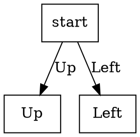

# Chat Transcription

---

**Me:** For this problem: 

> 80-Tile:
> For a moment, let us think about a new version of the previous game, the 80-tile, much harder than the 8-tile. It is the same original idea of the game, but now on a 9x9 matrix (something similar to Sudoku). Each tile is numbered from 1 to 9 but with a surname A, B, C, D, E, F, G, H, or I (as in Fig. 01) depending on the quadrant where the tile is located. Only quadrant I has an empty space, so tile 9H does not exist. Your job is to achieve the smallest number of moves (shortest path) while exploring the smallest possible number of states, using one or several heuristics (check the course textbook for ideas), in order to reach the configuration of Fig. 02 (take into account that each quadrant must be ordered as shown in Fig. 03 and that it starts as shown in that same figure). Show a portion of the explored tree, the total number of states generated, the total number of states analyzed and the length of the path found.

I need to show a portion of the search tree. How can I build/render it in Python? Give me a simple syntax example.

**AI:** Sure! For the report you only need a *portion* of the tree, not the whole search (the 80-tile graph is huge). A simple way in Python is to write a Graphviz DOT file while you expand the search: each node is a board state, each arrow is a blank move (`Up`, `Down`, `Left`, `Right`). Then paste the file into https://edotor.net (or run Graphviz locally) and you get a figure for the PDF.

The syntax is just a directed graph. A tiny example from the start (two legal moves) looks like this:



In Python you can emit that with ordinary `write()` calls, for example:

```python
def write_dot(path, root, successors, max_depth):
    f = open(path, "w")
    f.write("digraph SearchTree {\n")
    f.write("    rankdir=TB;\n")
    f.write("    node [shape=box];\n")
    counter = [0]

    def walk(state, depth, node_id):
        f.write("    " + node_id + " [label=\"" + str(node_id) + "\"];\n")
        if depth == max_depth:
            return
        for child, action in successors(state):
            counter[0] = counter[0] + 1
            child_id = "n" + str(counter[0])
            f.write("    " + node_id + " -> " + child_id + " [label=\"" + action + "\"];\n")
            walk(child, depth + 1, child_id)

    walk(root, 0, "n0")
    f.write("}\n")
    f.close()
```

`successors(state)` is whatever function returns the next boards and move names. Stop at `max_depth` 2 or 3; that is enough for the homework. You can put the heuristic value in the node label if you want (`h=...`).

If you prefer something even simpler, an ASCII tree with `├──` / `└──` also works, but DOT is usually cleaner for the report.

---

**Me:** Can you give me academic/trustworthy sources to investigate this?

> Chess vs. Go:  
> In class we talked about games and, in particular, we mentioned two of them: chess and go. In both games, at different points in history, computers appeared that were trained to play them. In this research exercise, investigate what the state of the art is for both chess and go, which algorithm or algorithms are the most advanced ones to play/train them, compare what you find for each game and answer: what is similar?, what is different?, what is the computational complexity of chess?, what is the computational complexity of go?, is it possible to use the classic BFS and DFS algorithms (or their maximization-minimization versions – minimax or alpha-beta pruning)?

**AI:** Here is a solid reading list so you can investigate each part of the prompt (SOTA, algorithms, similarities/differences, complexity, and whether BFS/DFS/minimax/alpha-beta are usable). Prefer these textbooks and peer-reviewed papers over blogs.

**Textbook / algorithms**

- Russell & Norvig, *Artificial Intelligence: A Modern Approach* — Ch. 3 (BFS/DFS) and Ch. 5 (minimax, alpha-beta, MCTS).
- Knuth, D. E., & Moore, R. W. (1975). An analysis of alpha-beta pruning. *Artificial Intelligence*. https://doi.org/10.1016/0004-3702(75)90019-3

**Complexity**

- Shannon, C. E. (1950). Programming a computer for playing chess. *Philosophical Magazine*. https://doi.org/10.1080/14786445008521796
- Fraenkel, A. S., & Lichtenstein, D. (1981). Computing a perfect strategy for n×n chess requires time exponential in n. *Journal of Combinatorial Theory, Series A*. https://doi.org/10.1016/0097-3165(81)90016-9
- Lichtenstein, D., & Sipser, M. (1980). GO is polynomial-space hard. *Journal of the ACM*. https://doi.org/10.1145/322186.322201
- Robson, J. M. (1983). The complexity of Go. *IFIP World Computer Congress*.
- Allis, L. V. (1994). *Searching for Solutions in Games and Artificial Intelligence* (PhD thesis). Game-tree / state-space estimates.

**Chess — history and SOTA**

- Campbell, M., Hoane, A. J., & Hsu, F.-h. (2002). Deep Blue. *Artificial Intelligence*. https://doi.org/10.1016/S0004-3702(01)00129-1
- Silver, D., et al. (2018). A general reinforcement learning algorithm that masters chess, shogi, and Go through self-play. *Science*. https://doi.org/10.1126/science.aar6404 (AlphaZero; preprint: https://arxiv.org/abs/1712.01815)
- Stockfish (current chess engines, alpha-beta + NNUE): https://stockfishchess.org/
- Leela Chess Zero (MCTS + neural net): https://lczero.org/

**Go — history and SOTA**

- Coulom, R. (2006). Efficient selectivity and backup operators in Monte-Carlo tree search. *Computers and Games*.
- Kocsis, L., & Szepesvári, C. (2006). Bandit based Monte-Carlo planning (UCT). *ECML*. https://doi.org/10.1007/11871842_29
- Silver, D., et al. (2016). Mastering the game of Go with deep neural networks and tree search. *Nature*. https://doi.org/10.1038/nature16961 (AlphaGo)
- Silver, D., et al. (2017). Mastering the game of Go without human knowledge. *Nature*. https://doi.org/10.1038/nature24270 (AlphaGo Zero)
- Wu, D. J. (2019). Accelerating self-play learning in Go. https://arxiv.org/abs/1902.10565 (KataGo)

When you write the comparison, cite the papers (DOI / Nature / Science / JACM), not random websites. For “state of the art today,” also check a current engine list (TCEC or CCRL for chess; KataGo / Leela Zero for Go) and put the date, because the engines keep changing.

If you want, I can later help you map each source to one of the questions in the prompt, but this list should be enough to start.